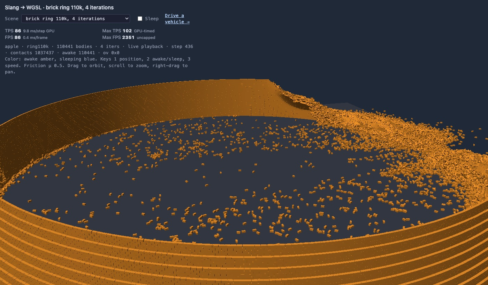
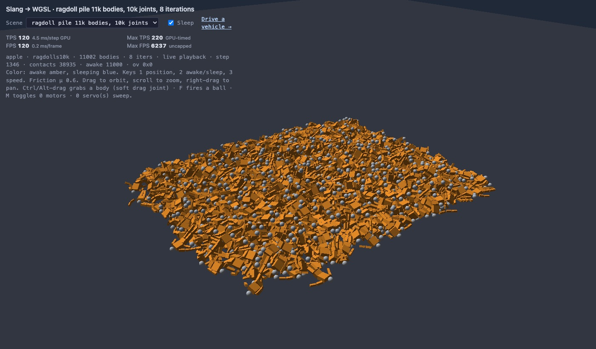
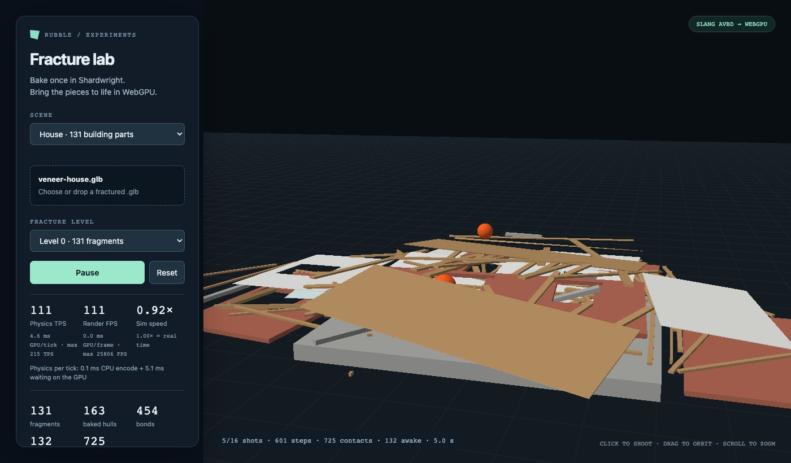
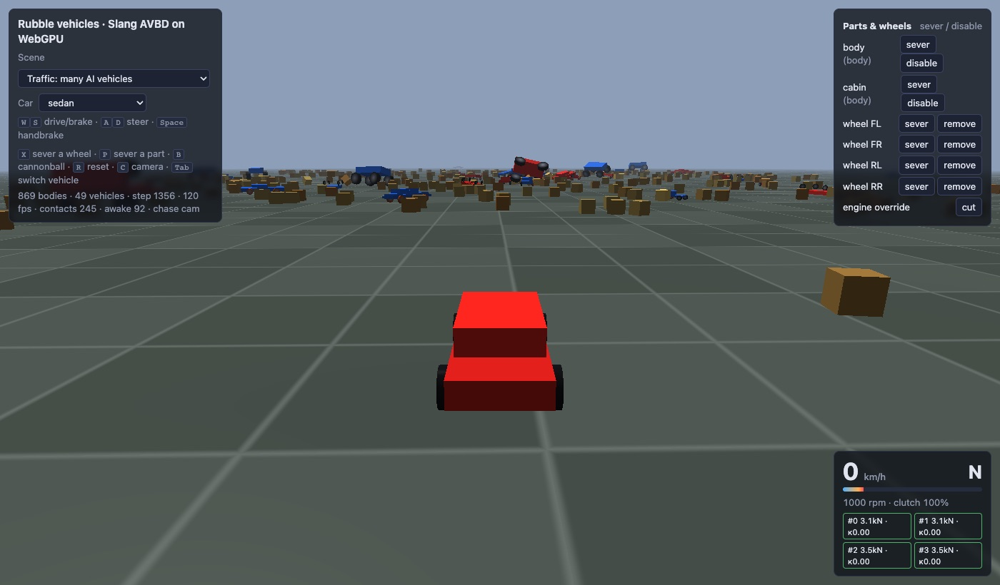
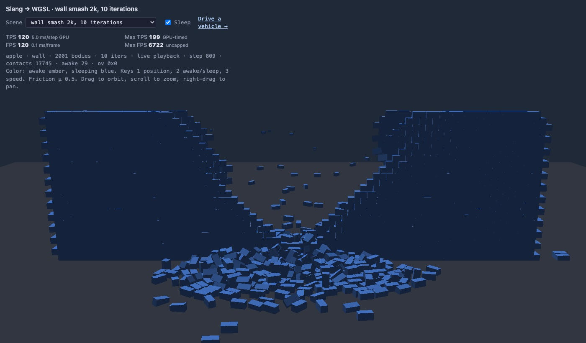
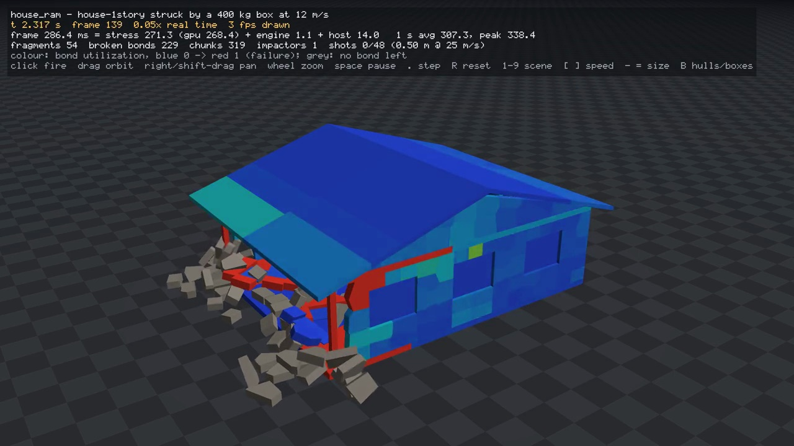

# rubble

GPU rigid-body physics with destruction, in Rust and [Slang](https://shader-slang.org/).
One Slang source for the solver compiles to Metal, WebGPU (native wgpu and the browser)
and CUDA. The engine lives in [`engine/`](engine/README.md).

**Live demos (WebGPU):** [rubble-tau.vercel.app](https://rubble-tau.vercel.app): the
scene gallery, the vehicle demo, the fracture lab, and the twelve scenes of the legacy
rubble demo rebuilt on the new engine for side-by-side comparison. Every pull request
gets a Vercel preview of the same site.

- **Solver:** AVBD (augmented vertex block descent) on the GPU, with island sleeping
- **Shapes:** boxes, spheres, capsules, convex hulls and compound bodies
- **Joints:** one D6 joint record (ball, hinge, slider, fixed, distance, spring, motors,
  limits, breakable); ragdolls and chains
- **Vehicles:** raycast wheels solved inside AVBD, drivetrains, tanks, motorcycles,
  parts you can break off
- **Destruction:** Shardwright fracture assets, a GPU stress solver that breaks bonds
  under load, and a CPU f64 stress reference to check it against
- **Scale:** aimed at 10,000+ active bodies; the browser demos run a 110k-brick ring and
  506k-body gables scenes
- **Game-facing API:** one `World` for bodies, shapes, joints, vehicles, soft bodies and
  destructibles, in Rust (the `rubble` crate) and C (`rubble.h`, with exact Unreal Z-up
  centimetre conversion)

<table>
<tr>
<td><br><sub><code>demo.html?scene=ring110k</code>: 110,441 bricks in Chrome WebGPU, about 10 ms/step</sub></td>
<td><br><sub><code>demo.html?scene=ragdolls10k</code>: 11,002 bodies, 10,001 D6 joints</sub></td>
</tr>
<tr>
<td><br><sub><code>fracture/</code>: a Shardwright house after five shots</sub></td>
<td><br><sub><code>vehicle.html?scene=traffic</code>: 49 drivable vehicles</sub></td>
</tr>
<tr>
<td><br><sub><code>demo.html?scene=wall</code>: wall smash, sleeping bodies in blue</sub></td>
<td><br><sub><code>destruction-view</code>: GPU stress solver, chunks coloured by bond load</sub></td>
</tr>
</table>

More screenshots: [engine/docs/media/combined-2026-10](engine/docs/media/combined-2026-10/README.md).

## Using Rubble

Rubble's public API is the `rubble` crate
([`engine/crates/engine-world`](engine/crates/engine-world)) and its C ABI
([`engine/crates/engine-ffi`](engine/crates/engine-ffi/README.md)). Both follow
[Box3D](https://box2d.org/)'s shape: definition structs with defaults, generational
handles passed by value, Box3D-named body commands, and events delivered per step.
The API is **0.x and unstable**; the full design and the phase plan are in
[engine/docs/public-api.md](engine/docs/public-api.md).

### How a frame works

- `step()` encodes one fixed step and returns at once. It never waits for the GPU.
- `poll()` returns every finished step, oldest first, as a `Frame`:
  - `body_events.moves`: only the bodies that moved, with the previous pose to
    interpolate from and sleep and wake transitions;
  - `destruction_events`: broken joints and bonds, and destructibles splitting into
    pieces (`Split` gives the parent and its children);
  - `vehicles`, `soft`, `skins`: per-frame vehicle wheels, soft-body nodes and skinned
    vertices;
  - `ray_results`: rays queued with `cast_rays`, traced against that step's poses;
  - `contact_events` and `sensor_events`: shapes that started or stopped touching, hits
    above a speed threshold (for sounds, effects and damage), and shapes entering or
    leaving sensors, for shapes that opt in.
- Body commands (impulses, forces, velocity, teleport, mass, kinematic targets) are
  queued and applied on the GPU at the start of the next step, so they never stall
  either.
- A world with nothing awake skips its steps.

### Rust

The `rubble` crate lives in the `engine/` workspace. It builds its GPU kernels with
`slangc` (version in [engine/TOOLCHAIN.md](engine/TOOLCHAIN.md)) and runs on wgpu
(Metal, Vulkan, D3D12). It can use your own `wgpu::Device` (`GpuContext::Shared`).

```rust
use rubble::*;

let mut world = World::new(GpuContext::Default, &WorldDef::default())?;

// Ground: a static body (the default) with a box shape.
let ground = world.create_body(&BodyDef { position: [0.0, -0.5, 0.0], ..BodyDef::default() })?;
world.create_box_shape(ground, &ShapeDef::default(), [40.0, 0.5, 40.0])?;

// A dynamic crate, pushed sideways.
let crate_ = world.create_body(&BodyDef::dynamic([0.0, 4.0, 0.0]))?;
world.create_box_shape(crate_, &ShapeDef::default(), [0.5; 3])?;
world.body_apply_linear_impulse_to_center(crate_, [2.0, 0.0, 0.0], true)?;

// A destructible from a Shardwright fracture asset.
let glb = std::fs::read("crates/engine-webgpu/fracture/assets/masonry-arch.glb")?;
let asset = world.create_destructible_asset(&DestructibleAssetDesc::from_glb(&glb, 1)?)?;
let mut arch = DestructibleDef::new(asset);
arch.transform = Transform::new([6.0, 0.0, 0.0], [0.0, 0.0, 0.0, 1.0]);
world.create_destructible(&arch)?;

loop {
    world.step()?;
    for frame in world.poll()? {
        for m in &frame.body_events.moves {
            // Interpolate m.previous -> m.transform in your renderer.
        }
        for e in &frame.destruction_events {
            if let DestructionEvent::Split { children, .. } = e {
                // Spawn render pieces: each chunk body's origin is its instance frame.
            }
        }
    }
}
```

Run it: `cd engine && cargo run -p engine-world --release --example quickstart`
([source](engine/crates/engine-world/examples/quickstart.rs)).

Beyond the basics:

- **Bodies:** static, dynamic and kinematic (`body_set_target_transform` moves a
  kinematic body to an animated pose each step, pushing and carrying what it touches),
  with damping, gravity scale and motion locks.
- **Shapes:** `create_sphere_shape`, `create_capsule_shape`, `create_box_shape`,
  `create_hull_shape` and ground planes, with materials, filters, an exact mass frame
  (the body origin is separate from its centre of mass), contact and hit events, and
  sensors (no response, overlap events). Level geometry is convex-decomposed at the
  source.
- **Joints:** typed `RevoluteJointDef`, `PrismaticJointDef`, `SphericalJointDef`,
  `WeldJointDef`, `DistanceJointDef` and `FilterJointDef`, breakable by force and torque.
- **Vehicles and soft bodies:** every preset or a JSON descriptor, gears, telemetry
  and damage (detach or disable wheels and parts); soft vehicles from `.truck`, JBeam or
  presets, with skinning, damage and a beam view. `create_assembly` and `create_vehicle`
  compose rigid, soft and destructible parts with mounts and joints.
- **Destruction:** destructibles from Shardwright GLBs, packs or procedural houses,
  breaking by bond strength, with the fracture lab's self-weight preload and solver
  settings available.
- **Queries and tooling:** `cast_rays` (asynchronous) and `cast_ray_blocking`;
  `World::draw` with a `DebugDraw` implementation draws every collider.

### C and C++ (Unreal, Unity, Godot, custom engines)

`engine/crates/engine-ffi` builds `librubble_ffi` (static and dynamic) with the
generated header [`include/rubble.h`](engine/crates/engine-ffi/include/rubble.h):

```c
#include "rubble.h"

RbWorldDef wd = rbDefaultWorldDef();
wd.coordinates = RB_COORDINATES_UNREAL;      /* Z-up, left-handed, centimetres */
wd.gravity = (RbVec3){0, 0, -981};
RbWorld* world;
if (rbCreateWorld(&wd, &world) != RB_OK) { puts(rbGetLastError()); }

RbBodyDef bd = rbDefaultBodyDef();
bd.type_ = RB_DYNAMIC_BODY;
bd.transform.p = (RbVec3){0, 0, 300};
RbBodyId body;
rbCreateBody(world, &bd, &body);

RbShapeDef sd = rbDefaultShapeDef();
sd.density = 0.0005f;                        /* kg/cm^3 */
RbShapeId shape;
rbCreateBoxShape(world, body, &sd, (RbVec3){50, 50, 50}, (RbTransform){0}, &shape);

for (;;) {
    rbWorld_Step(world);                     /* never waits */
    RbFrame f;
    rbWorld_Poll(world, /*coalesce*/ true, /*wait*/ false, &f);
    for (uint32_t i = 0; i < f.move_count; ++i) { /* f.moves[i].previous -> .transform */ }
    for (uint32_t i = 0; i < f.destruction_count; ++i) { /* breaks and splits */ }
}
rbDestroyWorld(world);
```

Definitions must come from their `rbDefault*Def()` function: one built any other way
returns `RB_INVALID_ARGUMENT`. See the [engine-ffi README](engine/crates/engine-ffi/README.md)
for the rules on handles, frames and coordinates.

## Documentation

| Topic | Where |
|-------|-------|
| Public API design, status and plan | [engine/docs/public-api.md](engine/docs/public-api.md) |
| How it compares with Box3D, Jolt, PhysX, Rapier, Chaos, Blast and others | [engine/docs/api-review.md](engine/docs/api-review.md) |
| The engine: crates, tests, benches, viewers | [engine/README.md](engine/README.md), [engine/DECISIONS.md](engine/DECISIONS.md) |
| Browser demos and WebGPU checks | [engine/crates/engine-webgpu/README.md](engine/crates/engine-webgpu/README.md) |
| Destruction stress solver | [engine/stress-oracle/README.md](engine/stress-oracle/README.md) |

## Contributing

Building from source, running the demos locally, the test suites, CI and the rules every
change follows (lossless performance work, forward-only destruction) are in
[CONTRIBUTING.md](CONTRIBUTING.md).
