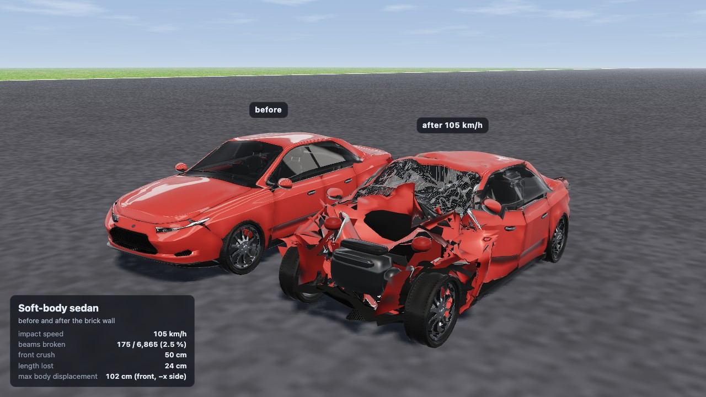

# Brick Ring Drive

Page: `engine/crates/engine-webgpu/brick-ring-drive.html`. Scene: `rubble::brick_ring_drive`
(`engine-world/src/brick_ring_drive.rs`). Wasm host: `engine-world-wasm/src/ring_drive.rs`.
Probe: `engine-world/examples/brick_ring_drive_probe.rs`. Recorder:
`engine-webgpu/brick-ring-drive-record.mjs`.

A soft-body car driven by the keys through the 110k brick ring of the rigid demos, in one
GPU World: the 2 kHz node–beam car (the explicit solver, BeamNG-style deformation) on
raycast wheels, and 110,440 AVBD rigid bricks, coupled both ways
(`explicit-vehicles-in-world.md`).

## Decisions

- **The ring is the demo's.** `RingSpec::demo()` reproduces `engine-scenes`
  `brick_ring_110k` / demo.html `?scene=ring110k` brick for brick (110,440 bricks of
  1 × 0.5 × 0.5 m, radius 80 m, 40 courses, a row less every 4 courses from 10). The World
  is the demo's (`ring_world_def`: 1/60 s, 4 iterations, persistent contacts, sparse colour
  start 10; `ring_world_def_is_the_demos` holds the values demo-config.mjs gives). A ring
  scaled to half size (0.5 × 0.25 × 0.25 m bricks) did not settle under the same solver
  settings (107k of 110k bodies still awake after 2.5 s, then a warm-hash overflow), so the
  scale stays 1: the bricks are big blocks next to the car.
- **Brick mass.** The demo's bricks weigh 0.25 kg (three-avbd's density 1 kg/m³): a 1.3 t car
  does not notice them. The drive's bricks are 100 kg/m³ (25 kg a block, a hay bale's
  density), stated in `drive_ring()`. Measured (native, ETK from 22 m/s): the car punches
  through the 5.2 m base, slowing from 27 to 7 m/s, 18 beams broken.
- **Sleep on.** The demo runs the ring without sleep for three-avbd parity; the drive turns the
  World's sleep on (0.5 s, demo.html's `?sleep=on`; `?sleep=0` on the page restores the
  demo's). The ring settles in about 3 s and only what the car disturbs is awake.
- **Raycast wheels.** The cars drive on the explicit solver's raycast wheels on their hubs
  (`engine_softbody::explicit_drive`, as softbody.html's drive scenes): the converted ETK has
  no tyres (BeamNG's shared content). The rays meet the vehicles' own ground, not the
  bricks: a car drives over loose bricks on its body's nodes.
- **The ground slab** is the demo's static box, in its own collision category that the
  vehicles' mask leaves out (the cars keep their own ground plane at its top).

## Results (2026-11-07, M3 Max, other agents' jobs on the machine)

**Baseline: the ring alone.**

| Run | Per World step |
|---|---|
| Chrome, demo.html `?scene=ring110k` (no sleep, the ball), frame-locked wall time | 10.6 ms |
| Chrome, the same with `&sleep=on` | 4.8 ms |
| Native, the demo's ring (no sleep, the ball), GPU | 13.0 ms (16–17 under load) |
| Native, the drive's ring alone (sleep on, no ball, 25 kg blocks), GPU, two runs | 4.5, 4.7 ms |

**With a car, in Chrome** (`brick-ring-drive-record.mjs --probe`, `?auto=1&timing=phases`,
headless, 60 Hz):

| Car | World steps/s | GPU per step (rigid · vehicle) |
|---|---|---|
| Soft-body sedan, cruising, ring asleep | 60 (100 %) | 4.2 ms (1.4 · 2.8) |
| Soft-body sedan, the first 3 s (the ring settling, 110k → 27k awake) | 56–60 | 7.7–12.1 ms |
| Soft-body sedan, pressed into the wall | 60 (100 %) | 9.7–10.7 ms (1.9 · 8.9) |
| ETK K-series, cruising | 47–54 (78–90 %) | 16.4–19 ms (2.3–7 · 13.5–14) |
| ETK K-series, through the wall | 39–53 | 16.7–19.7 ms (2.4 · 15–17.4) |

- The sedan drives, strikes and pushes bricks in real time. The rigid side's cost with the
  car (1.4 ms asleep, 1.9 ms with the struck bricks awake) is the ring's own.
- The ETK's own 2 kHz frame is 13.5 ms a World step in Chrome (457 nodes and 3,800 beams on
  one workgroup), so it is not real time on its own. That waits on `perf/explicit-2khz`.

**What the cars do.**
- The ETK at 111 km/h goes through the 5.2 m base and comes out at 40 km/h, with 43–72
  beams broken. A tunnel of blocks bursts out of the far face, and the wall above stands.
- The authored sedan on raycast wheels tops out at about 41 km/h with the explicit solver's
  air drag and turbulence on, on the CPU reference as on the GPU. So it is the drag model,
  not the World. Without drag (`?drag=0`) it reaches 33 m/s and still climbs. At 41 km/h it
  stops in the wall (31–35 beams broken). With `?drag=0` it hits at 99 km/h, crumples (158
  beams broken), breaks out to z = 90 m, and stays real time: 54–60 World steps/s, at most
  9.7 ms GPU a step (vehicle 8.8). The drag's effect on that car is a follow-up; the default
  keeps drag on.
- Coupling room: at most 122 proxy shapes per car were seen (sampled every 15 steps, the
  ETK at 28 m/s into the wall), of the 1,024 it has. So the room was not raised.

**Correctness.**
- `engine-world/tests/explicit_drive_world.rs`: the sedan on raycast wheels, driven through
  the World's explicit vehicles, matches the CPU reference bit for bit over 170 World steps.
  The run crosses the origin rebase.
- The origin rebase of a coupled vehicle (100 m from the origin) hung the GPU on this
  branch. The fix was `feat/vehicle-sleep`'s `cplRebase` header fix, now merged. The
  repro, the ETK driven past 100 m, now runs to 180 m.

**Videos** (`~/Development/rubble-artifacts/brick-ring-drive/`, 1280 × 720, 60 fps,
frame-locked, recorded with `brick-ring-drive-record.mjs`):
- `brick-ring-drive-etk.mp4`: the ETK's 100 m run-up and the strike, from the chase, the
  wall's side and outside the ring, then the strike again ×4 slower from the wall's side and
  from outside;
- `brick-ring-drive-etk2.mp4`: the same with two ETKs;
- `brick-ring-drive-sedan.mp4`: the authored sedan, `?drag=0`, at 99 km/h. This is the car
  that runs in real time.

Stills: `docs/media/brick-ring-drive/` (the sedan; the ETK's are not included).

## The ETK in real time: with perf/explicit-2khz (2026-11-07)

Branch `demo/brick-ring-etk-realtime`: `demo/crash-orbit` with `perf/explicit-2khz` merged
(the explicit 2 kHz frame's lossless speed-ups, bit-identical). There were no conflicts: the
ring drive does not touch the explicit Params (88 loop budget, 89 triangle geometry, 90
grid-walk pairs, 91 pad). Checks on the merge, each under the GPU lock and a kill timer:
`engine-world` `explicit_drive_world` (the sedan driven through the World matches the CPU
reference bit for bit across the origin rebase) and `explicit_vehicles`, and `engine-webgpu`
`explicit_beams_bitwise`, `explicit_contact_gpu` and `explicit_loop_cap`. All pass.

**Chrome, headless, interleaved A/B** (`tools/brick-ring-drive/chrome-ab.sh`: two rounds,
base then merged, each run its own Chrome under `with-gpu-lock.py`). The base is the
a86e3f52 build. Each case is the page's own real-time loop (`?auto=1&timing=phases`). GPU
times are per World step, rigid · vehicle, read each second.

| Case | Base a86e3f52: steps/s | GPU ms | Merged: steps/s | GPU ms |
|---|---|---|---|---|
| ETK, cruising (ring asleep, 85–110 km/h) | 55–58 | 15.5–16.4 (2.2–3.5 · 13.2–13.5) | **60** | 9.5–10.6 (1.7–2.8 · 7.8–8.0) |
| ETK, through the wall to rest | 39–59 | 15.4–19.5 (1.6–2.5 · 14.5–17.2) | **58–60** | 9.5–14.7 (1.7–2.4 · 8.5–12.5) |
| Two ETKs, cruising | 44–56 | 15.1–16.7 (1.3–2.3 · 13.4–14.3) | **60** | 9.5–11.0 (1.3–3.6 · 7.9–8.1) |
| Two ETKs, through the wall (touching) | 20–48 | 15.2–19.5 (1.2–1.8 · 15–21) | 26–57 | 9.4–29.9 (1.5–2.7 · 10–21.3) |
| Sedan, cruising | 60 | 2.9–3.0 (0.6–0.7 · 2.4–2.6) | 60 | 2.9–3.0 (0.6–0.7 · 2.4–2.5) |
| Sedan, in the wall | 60 | 9.0–9.5 (1.6–2.2 · 5.5–7.5) | 60 | 9.0–9.5 (1.6–2.2 · 5.6–7.5) |
| The ring alone, demo.html `?scene=ring110k&sleep=on`, wall ms a step (`ring-alone-chrome.mjs`, still settling: 65k → 26k awake) | | 5.3–9.2 | | 5.0–9.5 |

- **The ETK is real time in Chrome.** On the merged build, live and not frame-locked, the
  single ETK holds 60 World steps/s from the run-up through the strike to rest (58–60).
  Its own frame went from 13.2–13.5 to 7.8–8.0 ms a step cruising. With the crushed car in
  the bricks it costs 8.5–12.5 ms, against 14.5–17.2 ms before.
- **Not real time: the first 2–3 s of a fresh page.** The 110k ring is settling into sleep
  (110k → 30k awake, rigid 20–30 ms a step) and runs at 15–50 steps/s on both builds. That
  is the ring's own cost, not the car's.
- **Two ETKs** run in real time on the run-up. Through the wall, the two cars touch and are
  solved as one explicit contact group, and the rate falls to 26–57 steps/s.
  `?timing=phases` segments after the wall (Chrome): "explicit contact groups" 21.3 ms a
  step, against 3.4 ms for "explicit solo vehicles" and 2.5 ms for the rigid passes.
  Natively the same (`tools/brick-ring-drive/native-wall.sh`, struck at 30 m/s): one ETK's
  solo frame is 12.8 ms; two ETKs touching cost 28.1 ms in "explicit large contact groups"
  and 24.4 ms in "explicit contact groups" (means over the steps that have them), a median
  of 75 ms a step. Native Metal is worse than Chrome there. The next step is a lossless
  parallel solve of a contact group: the group's vehicles spread over workgroups and
  exchange contacts, so they are not solved on one workgroup.
  `perf/explicit-2khz` measured the same kind of cost for the page car's group of four
  (18 ms).
- The sedan and the ring alone are unchanged (within the runs' spread).

**Videos v2** (`~/Development/rubble-artifacts/brick-ring-drive/`, recorded on the merged
build; the old clips are kept):
- `brick-ring-drive-etk-v2.mp4`: the ETK (strike at 6.43 s, 15.4 s real time plus 12.3 s
  of ×4 replays);
- `brick-ring-drive-etk2-v2.mp4`: two ETKs, the same script.

The recorder steps the World frame-locked (one 1/60 s step per video frame), so a clip's
pacing does not depend on the machine. What changed is that the single-ETK clip now matches
what the live page does in Chrome: 60 World steps/s, wall clock. The two-car clip is
real time up to the strike. After the cars touch, the live page runs at 26–57 steps/s.
Stills: `out/stills-v2/` in the worktree (not committed; community car).

## The cars after the wall (crash orbit)

`crash-orbit.mjs` (engine-webgpu) runs the scripted drive frame-locked, saves the car at
rest and after the wall (`window.__snapshot`: world node positions, broken beams, and the
node, beam, misc and render-state buffers the renderer skins from), measures the crush, and
records `crash-orbit.html`: the snapshot drawn by the drive's own renderer
(`showcase-car-render.mjs`, same visual mesh, tears, glass and paint wear), alone on plain
asphalt, one 360° orbit in 12 s. `?snap=a.json,b.json` puts two side by side (before /
after). Snapshots live in `out/crash-orbit/` (gitignored; the ETK's are community content,
never committed) and `~/Development/rubble-artifacts/crash-orbit/`, with the videos.
Every browser run goes through `engine/scripts/with-gpu-lock.py`.

    node crash-orbit.mjs capture etk sedan     # <car>-rest.json, <car>-crash.json
    node crash-orbit.mjs measure etk sedan     # metrics into <car>-crash.json
    node crash-orbit.mjs record crash-orbit-etk etk-crash.json
    node crash-orbit.mjs record crash-orbit-etk-before-after etk-rest.json,etk-crash.json

**Crush** (2026-11-07). Measured in the rest car's frame: the crashed nodes rigidly aligned
(Kabsch) on the rear two fifths, iterated on the nodes within 3 cm (RMS 5–6 mm). Front
crush: how far back the nodes within 10 cm of the rest nose went. Nodes more than 1.5 m from
their place are counted as torn off, not crush.

| | ETK K-series | Soft-body sedan (`?drag=0`) |
|---|---|---|
| Impact speed (frame of the strike) | 113 km/h | 105 km/h |
| Snapshot | 2.8 s after the strike, out of the ring, stopped | 8.9 s after, at rest in the brick pile |
| Beams broken | 43 / 3,800 (1.1 %) | 175 / 6,865 (2.5 %) |
| Front crush, mean (max) of the nose nodes | 15 cm (29 cm) | 50 cm (88 cm) |
| Overall length lost | 9 cm of 3.92 m | 24 cm of 4.69 m |
| Largest body displacement | 1.20 m, rear quarter, right | 1.02 m, front, left |
| Nodes moved > 10 cm | 42 of 457 | 178 of 987 |
| Torn off | 5 nodes (a small part), left 9.5 m behind | none |

- The sedan is wrecked: the bonnet and wings are gone, the engine block is bare, the
  windscreen shattered, the front wheels splayed. Its rear is crushed too (up to 61 cm in the
  rear fifth): bricks came down on it in the pile.
- The ETK is hurt but whole: the bonnet buckled up and split, the grille and lamps pushed
  in, the cabin, doors and rear untouched. 15 cm of crush at 113 km/h into 25 kg blocks is
  little (a real car loses most of its crumple zone, 0.5–0.8 m, into a rigid wall at that
  speed, though this wall gives way). The converted car looks too strong in this crash.

## After the crash: stills and inspect mode (2026-11-07)

After the strike the bricks cover the car in the drive's own views, so the damage was hard
to see. There are two ways to see it now. Both are rendering and camera only: the World
steps unchanged.

**Post-crash stills.** `crash-orbit.mjs capture etk etk2 sedan --after 2` snapshots each
car 2 s after it is out of the wall or at rest (`etk2`: both cars of the two-ETK run,
`etk2-0-…` and `etk2-1-…`, each in its own paint and vehicle slot). `crash-orbit.mjs
stills <name> <snap>[,<snap>]` renders crash-orbit.html at set views about the car's
heading, framed tight: `front34`, `side`, `rear34` and `topfront` (`--views`). With two
snapshots (rest, crash) it renders a before/after pair. The crush measure is now
`crash-measure.mjs`, which crash-orbit.mjs and the drive page share. It gives the same
output as before. The stills and snapshots are in `~/Development/rubble-artifacts/post-crash/`
(not committed: the ETK is community content).

| Car (this build, frame-locked) | Impact | Beams broken | Front crush mean (max) | Length lost | Body max |
|---|---|---|---|---|---|
| ETK | 113 km/h | 67 / 3,800 | 14 cm (28 cm) | 8 cm | 49 cm, rear quarter |
| Two ETKs: the first (red) | 113 km/h | 19 / 3,800 | 14 cm (27 cm) | 8 cm | 73 cm, rear quarter |
| Two ETKs: the second (blue, spun about 90° after the wall) | 121 km/h | 42 / 3,800 | 8 cm (12 cm) | 7 cm | 20 cm, front quarter |
| Sedan `?drag=0` | 105 km/h | 183 / 6,865 | 54 cm (101 cm) | 24 cm | 139 cm, middle |

**Inspect mode (brick-ring-drive.html).** Press `I`, or use `?inspect=auto` to start it
once every car has struck the wall and stood still for 1 s (or 8 s after the strike). The
bricks on and around the car (body centre within half the car's length + 1.3 m of its
vertical axis) and those between the camera and the car (within 2.2 m of that line) are
ghosted. They are drawn after the cars as outlines over a faint fill, and they cast no
shadow (`env.setCut` / `env.drawGhosts` in one-world-render.mjs). The camera goes once
around the car in 12 s (`?inspectSecs=`), starting at its front three-quarter. The panel
shows the impact speed, the car's broken beams, and its crush. The crush is
crash-measure.mjs run on the car's nodes now against the same car at 0.25 s, before the
throttle. With two cars, each is inspected in turn. Press `I` or `Esc` to return to the
normal view (a click also does this).

The recorder's `--inspect` appends this orbit (one per car) after the ×4 replays. It is
recorded on the real-time pass's crashed cars, from 9 s after the strike:

    node brick-ring-drive-record.mjs etk-v3:car=etk etk2-v3:car=etk\&n=2 "sedan-v3:car=sedan&drag=0" --inspect

Videos v3 (`~/Development/rubble-artifacts/brick-ring-drive/`; the older clips are kept):
`brick-ring-drive-etk-v3.mp4`, `brick-ring-drive-etk2-v3.mp4`, `brick-ring-drive-sedan-v3.mp4`.
The clips are 39.8 s (ETK: 15.4 s real time, 12.3 s of replays, 12 s of inspect),
51.8 s (two ETKs: 24 s of inspect) and 40.3 s (sedan). The panel's impact speed is the
car's speed on the frame before the strike is seen: 111 km/h for the sedan. The
crash-orbit capture gives 105 km/h, the speed on the strike's own frame. The runs are not
bit-reproducible in Chrome (for example, the sedan broke 160–185 beams over four runs),
so the numbers vary a little from clip to clip.

Seen once (not fixed here, since this work is rendering only): a sedan `?drag=0` replay
stopped at World step 422 with "explicit vehicles: more colliders than the shapes room
(capacity … shapes: 1024)". The coupling room that the earlier sampling said was never
more than 122 shapes a car can be exceeded by the sedan in the pile. Raising
`ExplicitVehiclesDef::capacity` (or failing more gracefully) is a follow-up. The re-run
recorded cleanly.
