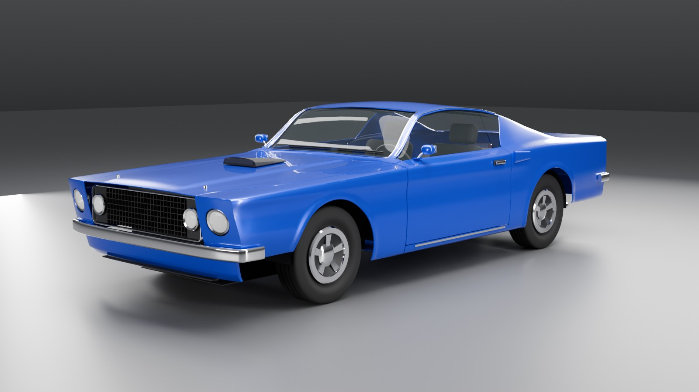

# 1969 fastback Mach 1 (electric blue)



Two-door SportsRoof fastback. Profiles read off side, front-3/4 and rear-3/4 photographs of real cars and scaled to the published dimensions (wheelbase 108 in, length 187.4 in, width 71.3 in, track 58.5 in). Quad lamps (outer in the fender buckets, inner in the egg-crate grille), chrome blade bumpers, Mach 1 bonnet scoop and pins, quarter scoops, hardtop (frameless) door glass, 14 in five-spoke wheels. No badges or logos.

Generated by [engine/tools/vehicle-gen](../../../tools/vehicle-gen) from
[designs/mach1_1969.py](../../../tools/vehicle-gen/designs/mach1_1969.py); rebuild with

```bash
/Applications/Blender.app/Contents/MacOS/Blender -b --python build.py -- mach1_1969
```

| File | |
| --- | --- |
| `mach1_1969.glb` | the delivery: glTF 2.0, metres, +Y up, front +Z, one root `vehicle` |
| `mach1_1969.blend` | Blender source (quads; the glb is beauty-triangulated) |
| `renders/` | front three-quarter, side, rear three-quarter, top |
| `checks.md` | the art spec's automatic checks, as measured on the glb |

## Measured

| Dimension | mm |
| --- | --- |
| Length | 4784 |
| Width (excluding mirrors) | 1861 |
| Height | 1300 |
| Wheelbase | 2743 |
| Track front / rear | 1486 / 1486 |
| Front overhang | 951 |
| Ground clearance | 149 |
| Tyre outer diameter | 662 |

| Triangles | |
| --- | --- |
| Body, closures, bumpers, fenders | 159,124 |
| Each wheel (rim, tyre, disc) | 13,268 |
| Interior | 24,992 |
| Lamps, glass, trim, bay, underbody | 37,272 |
| Total | 274,460 |

Khronos glTF Validator: 0 errors, 0 warnings. No textures (flat PBR factors
on the spec's ten materials).

## Notes

- Two doors, so the spec's rear-door parts and markers do not exist (`check.py --doors FL,FR`).
- Width includes the quarter scoops and bumper ends; the body itself is 1,812 mm.
- The shape reproduces a real production car; trade dress belongs to its maker. Fine for Rubble's own demos; check before shipping it in a commercial product.

Licence: CC-BY 4.0, the Rubble authors (as the art spec asks); the geometry is
generated by our own scripts, with no third-party meshes or textures.

## Acceptance checks

`check.py -- mach1_1969.glb --doors FL,FR`. "No part pairs cross (any depth)" is
stricter than the spec's 1 mm interpenetration rule and is informational.

| check | result | detail |
|---|---|---|
| one root named `vehicle` | pass | roots ['vehicle'] |
| flat hierarchy | pass | 96 children of `vehicle` |
| every part present | pass | 60 parts; missing [] |
| every marker present | pass | 36 markers; missing []; fender bolts 4, bumper bolts 4 |
| materials use only the spec names | pass | 10 materials; others [] |
| glass transparent, roughness <= 0.05 | pass | [('BLEND', 0.019999999552965164)] |
| dimensions (measured) | pass | length 4784 mm, width 1861 mm, height 1300 mm, wheelbase 2743 mm, track_f 1486 mm, track_r 1486 mm, front_overhang 951 mm, ground_clearance 149 mm, tyre_d 662 mm, origin_mid_axles 0 mm, origin_centre_x 0 mm |
| origin on the ground, centred, midway between axles | pass | axle midpoint z 0.0 mm, centre x 0.0 mm, min y -0.0 mm |
| tyres touch y = 0; wheel centres within 5 mm of markers | pass | tyre min y [-0.0, -0.0, -0.0, -0.0] mm; centre error [0.0, 0.0, 0.0, 0.0] mm |
| no non-manifold edges | pass | {} |
| no zero-area triangles | pass | {} |
| no inverted normals | pass | {} |
| panel edge p95 <= 30 mm | pass | p5 8.4, p50 19.8, p95 27.8 mm |
| panel triangle aspect <= 6:1 | FAIL | p99 4.62, max 18.55; over 6: {'body_shell': 41, 'door_FL': 1, 'fender_FL': 28, 'fender_FR': 28, 'hood': 4, 'trunk_lid': 4}; worst {'body_shell': (16.0, [0.662, 1.174, -0.88], [((-0.7, 1.2, -0.9), 7), ((0.8, 0.9, 0.6), 6), ((-0.8, 0.9, 0.6), 6)]), 'door_FL': (6.2, [0.79, 0.88, 0.622], [((0.8, 0.9, 0.6), 1)]), 'fender_FL': (18.1, [0.77, 0.732, 2.279], [((0.8, 0.7, 2.3), 9), ((0.7, 0.7, 2.3), 9), ((0.8, 0.6, 2.2), 5)]), 'fender_FR': (18.1, [-0.77, 0.732, 2.279], [((-0.8, 0.7, 2.3), 9), ((-0.7, 0.7, 2.3), 9), ((-0.8, 0.6, 2.2), 5)]), 'hood': (11.2, [0.771, 0.881, 0.635], [((0.8, 0.9, 0.6), 2), ((-0.8, 0.9, 0.6), 2)]), 'trunk_lid': (18.6, [-0.794, 0.946, -1.775], [((0.8, 1.0, -1.8), 1), ((-0.8, 1.0, -1.8), 1), ((-0.8, 0.9, -1.8), 1)])} |
| triangle budget | pass | body 159124 (150k-300k), wheel max 13268 (<= 15k), interior 24992 (<= 80k), lamps/glass/trim/bay 37272 (<= 60k), total 274460 (<= 500k) |
| shut-line gaps 3-6 mm | pass | 1406 border cells: min 3.6, p5 4.1, p50 4.6, p95 5.2 mm; under 3 mm: {}; over 6 mm: {'body_shell/trunk_lid': 12}; e.g. {'>6 body_shell/trunk_lid': [-0.72, 0.92, -2.42]} |
| no panel interpenetration over 1 mm | pass | deepest 0.0 mm  |
| no part pairs cross (any depth) | FAIL | 1 pairs: {'body_shell/trunk_lid': 84} |
| UV0 non-overlapping on painted panels | pass | 1011693 texels at 2048^2, 0 covered twice {} at uv {}; all in [0,1]: True |
| texture memory within 64 MB | pass | 0 images (materials are flat PBR factors) |
