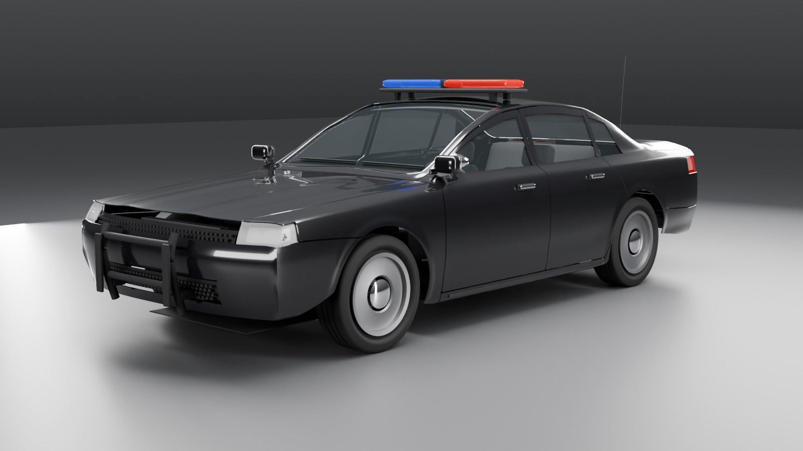

# Police interceptor



The mid-size sedan in gloss black on steel wheels, with a roof light bar (red left, blue right, on four feet), a push bar following the nose, an A-pillar spotlight and a boot-lid antenna. Derived from the sedan: [designs/police_sedan.py](../../../tools/vehicle-gen/designs/police_sedan.py) holds only the paint, wheels and equipment.

Rebuild from [engine/tools/vehicle-gen](../../../tools/vehicle-gen):

```bash
/Applications/Blender.app/Contents/MacOS/Blender -b --python build.py -- police_sedan
```

| File | |
| --- | --- |
| `police_sedan.glb` | the delivery: glTF 2.0, metres, +Y up, front +Z, one root `vehicle` |
| `police_sedan.blend` | Blender source (quads; the glb is beauty-triangulated) |
| `renders/` | front three-quarter, side, rear three-quarter, top |
| `checks.md` | the art spec's automatic checks, as measured on the glb |

Khronos glTF Validator: 0 errors, 0 warnings. The spec's sedan dimension tolerances fail by design: the push bar adds length and the antenna height. The other failing checks are the sedan's own, unchanged.

Licence: CC-BY 4.0, the Rubble authors; generated by our own scripts, with no
third-party meshes or textures.

## Acceptance checks

`check.py -- police_sedan.glb --sedan`

| check | result | detail |
|---|---|---|
| one root named `vehicle` | pass | roots ['vehicle'] |
| flat hierarchy | pass | 115 children of `vehicle` |
| every part present | pass | 73 parts; missing [] |
| every marker present | pass | 42 markers; missing []; fender bolts 4, bumper bolts 4 |
| materials use only the spec names | pass | 10 materials; others [] |
| glass transparent, roughness <= 0.05 | pass | [('BLEND', 0.019999999552965164)] |
| dimensions (measured) | pass | length 4985 mm, width 1882 mm, height 1766 mm, wheelbase 2830 mm, track_f 1600 mm, track_r 1600 mm, front_overhang 1075 mm, ground_clearance 139 mm, tyre_d 683 mm, origin_mid_axles 0 mm, origin_centre_x 0 mm |
| dimensions within the sedan tolerances | FAIL | length 4985 (target 4880 ± 50); height 1766 (target 1450 ± 30); front_overhang 1075 (target 970 ± 50) |
| origin on the ground, centred, midway between axles | pass | axle midpoint z 0.0 mm, centre x 0.0 mm, min y 0.0 mm |
| tyres touch y = 0; wheel centres within 5 mm of markers | pass | tyre min y [0.0, 0.0, 0.0, 0.0] mm; centre error [0.0, 0.0, 0.0, 0.0] mm |
| no non-manifold edges | pass | {} |
| no zero-area triangles | pass | {} |
| no inverted normals | FAIL | {'body_shell': (3, [0.896, 0.268, -0.974]), 'bumper_front': (2, [0.927, 0.69, 1.614]), 'bumper_rear': (2, [-0.927, 0.562, -1.753]), 'door_FL': (2, [0.713, 1.005, 0.734]), 'door_RL': (2, [0.893, 0.946, -1.015]), 'door_RR': (3, [-0.686, 1.307, -0.973])} |
| panel edge p95 <= 30 mm | pass | p5 6.6, p50 19.9, p95 28.2 mm |
| panel triangle aspect <= 6:1 | FAIL | p99 5.24, max 427.16; over 6: {'body_shell': 242, 'bumper_front': 68, 'bumper_rear': 3, 'door_FL': 53, 'door_FR': 53, 'door_RL': 52, 'door_RR': 48, 'fender_FL': 30, 'fender_FR': 30, 'hood': 2, 'trunk_lid': 12}; worst {'body_shell': (268.5, [-0.6, 1.385, -0.108], [((0.8, 1.1, -1.7), 30), ((-0.8, 1.1, -1.7), 30), ((-0.9, 0.3, -1.0), 24)]), 'bumper_front': (9.7, [-0.897, 0.695, 2.214], [((0.9, 0.7, 1.8), 8), ((-0.9, 0.7, 1.8), 8), ((0.9, 0.7, 2.0), 7)]), 'bumper_rear': (14.4, [-0.927, 0.562, -1.753], [((-0.8, 0.3, -2.4), 1), ((-0.9, 0.6, -1.8), 1), ((0.9, 0.6, -1.8), 1)]), 'door_FL': (427.2, [0.713, 0.999, 0.747], [((0.7, 1.0, 0.8), 19), ((0.7, 1.0, 0.7), 10), ((0.7, 1.1, 0.6), 10)]), 'door_FR': (404.2, [-0.713, 0.999, 0.747], [((-0.7, 1.0, 0.8), 19), ((-0.7, 1.0, 0.7), 10), ((-0.7, 1.1, 0.6), 10)]), 'door_RL': (35.6, [0.897, 0.936, -1.021], [((0.9, 0.9, -1.0), 10), ((0.9, 0.4, -1.0), 9), ((0.7, 1.3, -1.0), 7)]), 'door_RR': (77.3, [-0.898, 0.936, -1.022], [((-0.9, 0.4, -1.0), 9), ((-0.9, 0.9, -1.0), 8), ((-0.7, 1.3, -1.0), 7)]), 'fender_FL': (6.4, [0.906, 0.723, 2.055], [((0.9, 0.7, 1.8), 8), ((0.9, 0.7, 2.0), 7), ((0.9, 0.7, 1.9), 6)]), 'fender_FR': (6.3, [-0.924, 0.702, 1.697], [((-0.9, 0.7, 1.8), 8), ((-0.9, 0.7, 2.0), 7), ((-0.9, 0.7, 1.7), 6)]), 'hood': (8.1, [-0.78, 0.934, 0.885], [((0.8, 0.9, 0.9), 1), ((-0.8, 0.9, 0.9), 1)]), 'trunk_lid': (6.7, [0.766, 1.062, -1.747], [((0.8, 1.1, -1.7), 3), ((-0.8, 1.1, -1.7), 3), ((0.8, 1.1, -1.8), 2)])} |
| triangle budget | pass | body 169436 (150k-300k), wheel max 11152 (<= 15k), interior 28856 (<= 80k), lamps/glass/trim/bay 43048 (<= 60k), total 285948 (<= 500k) |
| shut-line gaps 3-6 mm | pass | 2130 border cells: min 0.2, p5 3.9, p50 4.6, p95 5.1 mm; under 3 mm: {'body_shell/door_RR': 10, 'body_shell/trunk_lid': 10, 'body_shell/door_RL': 9}; over 6 mm: {'body_shell/trunk_lid': 60}; e.g. {'<3 body_shell/door_RR': [-0.94, 0.38, -1.04], '<3 body_shell/trunk_lid': [-0.8, 1.04, -1.76], '>6 body_shell/trunk_lid': [-0.4, 1.04, -2.46], '<3 body_shell/door_RL': [0.9, 0.34, -1.02]} |
| no panel interpenetration over 1 mm | FAIL | deepest 2.8 mm door_RR into body_shell at [-0.918, 0.373, -1.009] |
| no part pairs cross (any depth) | FAIL | 10 pairs: {'headlight_L_housing/headlight_L_lens': (47, [0.89, 0.74, 2.14]), 'fender_FL/headlight_L_lens': (45, [0.74, 0.82, 2.2]), 'headlight_R_housing/headlight_R_lens': (44, [-0.89, 0.75, 2.14]), 'fender_FR/headlight_R_lens': (42, [-0.74, 0.82, 2.2]), 'body_shell/door_RL': (11, [0.92, 0.38, -1.01]), 'body_shell/taillight_L_lens': (6, [0.85, 0.95, -2.36]), 'headlight_L_lens/hood': (5, [0.65, 0.82, 2.23]), 'headlight_R_lens/hood': (5, [-0.65, 0.82, 2.23]), 'body_shell/taillight_R_lens': (3, [-0.85, 0.95, -2.36]), 'bumper_front/headlight_R_lens': (2, [-0.9, 0.69, 2.21])} |
| UV0 non-overlapping on painted panels | pass | 1037784 texels at 2048^2, 0 covered twice {} at uv {}; all in [0,1]: True |
| texture memory within 64 MB | pass | 0 images (materials are flat PBR factors) |
