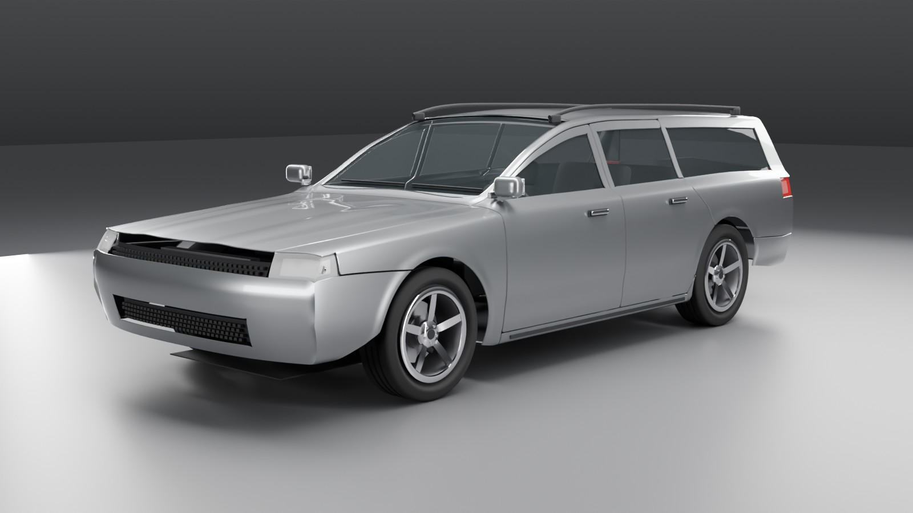

# Estate wagon



The mid-size sedan's nose, doors and wheels with the roof carried level to the tail, long cargo windows behind the rear doors, a forward-leaning tailgate carrying the back light between tall D-pillar lamps, and roof rails. Silver. Derived from the sedan: [designs/wagon.py](../../../tools/vehicle-gen/designs/wagon.py) overrides the three roof key lines, the tail face, the panel assignment behind the B-pillar and the tail cap (the 4x4's tailgate layout).

Rebuild from [engine/tools/vehicle-gen](../../../tools/vehicle-gen):

```bash
/Applications/Blender.app/Contents/MacOS/Blender -b --python build.py -- wagon
```

| File | |
| --- | --- |
| `wagon.glb` | the delivery: glTF 2.0, metres, +Y up, front +Z, one root `vehicle` |
| `wagon.blend` | Blender source (quads; the glb is beauty-triangulated) |
| `renders/` | front three-quarter, side, rear three-quarter, top |
| `checks.md` | the art spec's automatic checks, as measured on the glb |

Khronos glTF Validator: 0 errors, 0 warnings. The failing checks are the sedan's own (front-end lamp crossings, a few inverted corner faces, thin rows round the rear door); the wagon's tail adds none.

Licence: CC-BY 4.0, the Rubble authors; generated by our own scripts, with no
third-party meshes or textures.

## Acceptance checks

`check.py -- wagon.glb --tailgate`

| check | result | detail |
|---|---|---|
| one root named `vehicle` | pass | roots ['vehicle'] |
| flat hierarchy | pass | 111 children of `vehicle` |
| every part present | pass | 69 parts; missing [] |
| every marker present | pass | 42 markers; missing []; fender bolts 4, bumper bolts 4 |
| materials use only the spec names | pass | 10 materials; others [] |
| glass transparent, roughness <= 0.05 | pass | [('BLEND', 0.019999999552965164)] |
| dimensions (measured) | pass | length 4855 mm, width 1882 mm, height 1483 mm, wheelbase 2830 mm, track_f 1600 mm, track_r 1600 mm, front_overhang 970 mm, ground_clearance 139 mm, tyre_d 683 mm, origin_mid_axles 0 mm, origin_centre_x 0 mm |
| origin on the ground, centred, midway between axles | pass | axle midpoint z 0.0 mm, centre x 0.0 mm, min y 0.0 mm |
| tyres touch y = 0; wheel centres within 5 mm of markers | pass | tyre min y [0.0, 0.0, 0.0, 0.0] mm; centre error [0.0, 0.0, 0.0, 0.0] mm |
| no non-manifold edges | pass | {} |
| no zero-area triangles | pass | {} |
| no inverted normals | FAIL | {'body_shell': (7, [0.896, 0.268, -0.974]), 'bumper_front': (2, [0.927, 0.69, 1.614]), 'bumper_rear': (2, [-0.927, 0.561, -1.755]), 'door_FL': (2, [0.713, 1.005, 0.734]), 'door_FR': (1, [-0.711, 0.981, 0.788]), 'door_RL': (1, [0.893, 0.946, -1.015]), 'door_RR': (2, [-0.893, 0.946, -1.014]), 'tailgate': (1, [0.65, 1.001, -2.432])} |
| panel edge p95 <= 30 mm | pass | p5 6.6, p50 19.9, p95 28.1 mm |
| panel triangle aspect <= 6:1 | FAIL | p99 4.89, max 425.90; over 6: {'body_shell': 157, 'bumper_front': 68, 'bumper_rear': 4, 'door_FL': 51, 'door_FR': 51, 'door_RL': 39, 'door_RR': 33, 'fender_FL': 30, 'fender_FR': 30, 'hood': 4, 'tailgate': 4}; worst {'body_shell': (315.0, [-0.65, 0.992, 0.776], [((-0.9, 0.3, -1.0), 24), ((0.9, 0.3, -1.0), 23), ((0.9, 0.4, -1.0), 10)]), 'bumper_front': (9.7, [-0.897, 0.695, 2.214], [((0.9, 0.7, 1.8), 8), ((-0.9, 0.7, 1.8), 8), ((0.9, 0.7, 2.0), 7)]), 'bumper_rear': (14.8, [-0.927, 0.561, -1.755], [((-0.9, 0.6, -1.8), 1), ((0.9, 0.5, -2.4), 1), ((0.9, 0.6, -1.8), 1)]), 'door_FL': (425.9, [0.713, 0.999, 0.747], [((0.7, 1.0, 0.8), 21), ((0.7, 1.0, 0.7), 10), ((0.7, 1.1, 0.6), 10)]), 'door_FR': (404.3, [-0.713, 0.999, 0.747], [((-0.7, 1.0, 0.8), 21), ((-0.7, 1.0, 0.7), 10), ((-0.7, 1.1, 0.6), 10)]), 'door_RL': (35.6, [0.897, 0.936, -1.021], [((0.9, 0.9, -1.0), 10), ((0.9, 0.4, -1.0), 9), ((0.9, 0.9, -1.1), 7)]), 'door_RR': (77.1, [-0.898, 0.936, -1.022], [((-0.9, 0.4, -1.0), 9), ((-0.9, 0.9, -1.0), 8), ((-0.9, 0.5, -1.0), 5)]), 'fender_FL': (6.4, [0.906, 0.723, 2.055], [((0.9, 0.7, 1.8), 8), ((0.9, 0.7, 2.0), 7), ((0.9, 0.7, 1.9), 6)]), 'fender_FR': (6.3, [-0.924, 0.702, 1.697], [((-0.9, 0.7, 1.8), 8), ((-0.9, 0.7, 2.0), 7), ((-0.9, 0.7, 1.7), 6)]), 'hood': (16.1, [-0.782, 0.934, 0.884], [((0.6, 0.8, 2.2), 1), ((-0.6, 0.8, 2.2), 1), ((0.8, 0.9, 0.9), 1)]), 'tailgate': (25.4, [-0.65, 0.999, -2.432], [((0.7, 1.0, -2.4), 2), ((-0.7, 1.0, -2.4), 2)])} |
| triangle budget | pass | body 169028 (150k-300k), wheel max 13784 (<= 15k), interior 28794 (<= 80k), lamps/glass/trim/bay 40596 (<= 60k), total 293554 (<= 500k) |
| shut-line gaps 3-6 mm | pass | 1892 border cells: min 0.0, p5 3.8, p50 4.6, p95 5.0 mm; under 3 mm: {'body_shell/door_RR': 24, 'body_shell/door_RL': 19}; over 6 mm: {'body_shell/tailgate': 6, 'body_shell/bumper_rear': 2}; e.g. {'<3 body_shell/door_RR': [-0.94, 0.38, -1.04], '>6 body_shell/bumper_rear': [-0.66, 0.54, -2.44], '>6 body_shell/tailgate': [-0.68, 1.0, -2.44], '<3 body_shell/door_RL': [0.8, 1.0, -1.0]} |
| no panel interpenetration over 1 mm | FAIL | deepest 4.1 mm body_shell into door_RR at [-0.821, 0.999, -1.01] |
| no part pairs cross (any depth) | FAIL | 11 pairs: {'headlight_L_housing/headlight_L_lens': (47, [0.89, 0.74, 2.14]), 'fender_FL/headlight_L_lens': (45, [0.74, 0.82, 2.2]), 'headlight_R_housing/headlight_R_lens': (44, [-0.89, 0.75, 2.14]), 'body_shell/door_RR': (42, [-0.82, 1.01, -1.02]), 'fender_FR/headlight_R_lens': (42, [-0.74, 0.82, 2.2]), 'body_shell/door_RL': (11, [0.92, 0.38, -1.01]), 'headlight_L_lens/hood': (7, [0.65, 0.82, 2.23]), 'headlight_R_lens/hood': (7, [-0.65, 0.82, 2.23]), 'body_shell/taillight_R_lens': (6, [-0.85, 0.95, -2.37]), 'body_shell/taillight_L_lens': (2, [0.85, 0.95, -2.38]), 'bumper_front/headlight_R_lens': (2, [-0.9, 0.69, 2.21])} |
| UV0 non-overlapping on painted panels | pass | 1099871 texels at 2048^2, 0 covered twice {} at uv {}; all in [0,1]: True |
| texture memory within 64 MB | pass | 0 images (materials are flat PBR factors) |
